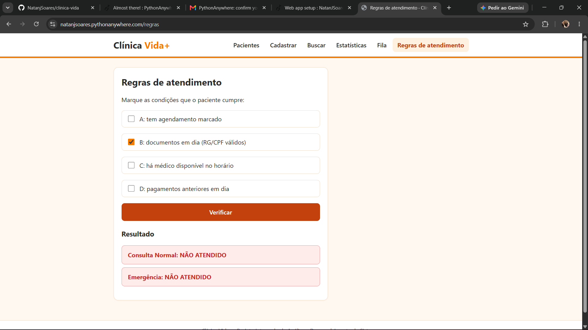
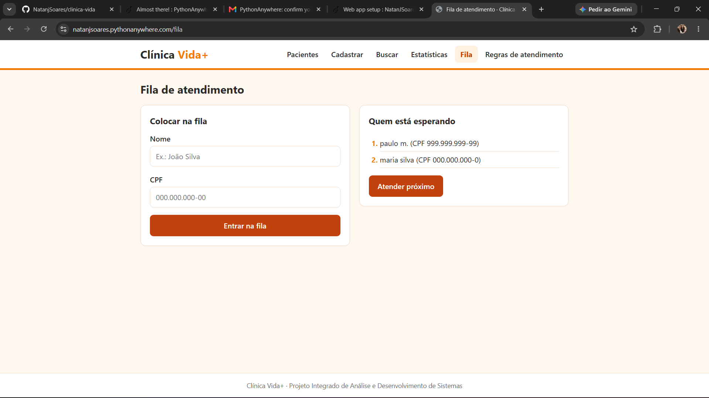
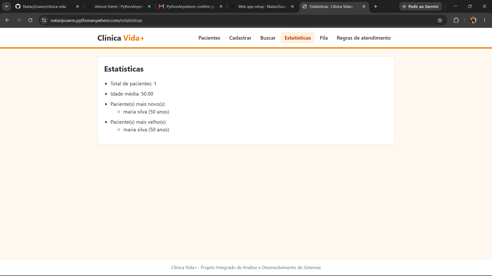
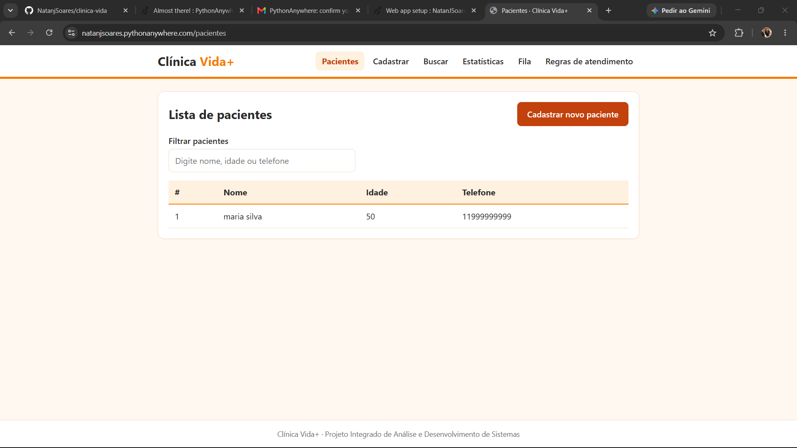

# Clínica Vida+

Aplicação web desenvolvida em Python e Flask como projeto de portfólio de Análise e Desenvolvimento de Sistemas (ADS). Demonstra organização modular, cadastro e consulta de pacientes em SQLite, fila de atendimento, regras de negócio, estatísticas e testes automatizados.

- **Demonstração:** https://natanjsoares.pythonanywhere.com
- **Repositório:** https://github.com/NatanjSoares/clinica-vida

> **Aviso importante:** esta é uma demonstração acadêmica/de portfólio. Não utilize para atendimento clínico real nem insira dados pessoais ou de saúde de pacientes. A versão publicada não possui autenticação e autorização adequadas para um sistema de saúde em produção.

## Funcionalidades implementadas

- Cadastro de pacientes com validação de nome, idade e telefone.
- Listagem de pacientes.
- Busca por nome.
- Estatísticas calculadas a partir dos pacientes cadastrados.
- Fila de atendimento com entrada e chamada do próximo registro.
- Avaliação de regras lógicas para consulta normal e emergência.
- Persistência dos pacientes em banco SQLite.

## Capturas de tela

Capturas da versão publicada, feitas com dados fictícios.

**Lista de pacientes**



**Cadastro com validação de dados**



**Estatísticas**



**Fila de atendimento**



**Regras de atendimento (tabela verdade)**


## Rotas principais

| Rota | Método | Finalidade |
|---|---|---|
| `/` | GET | Redireciona para a listagem |
| `/pacientes` | GET | Lista pacientes |
| `/pacientes/novo` | GET/POST | Formulário e cadastro |
| `/pacientes/buscar` | GET | Busca por nome |
| `/estatisticas` | GET | Exibe estatísticas |
| `/fila` | GET | Exibe a fila |
| `/fila/entrar` | POST | Adiciona à fila |
| `/fila/proximo` | POST | Chama o próximo |
| `/regras` | GET/POST | Exibe e avalia regras lógicas |

## Tecnologias

- Python 3.13
- Flask 3.1.3
- SQLite
- HTML, CSS e JavaScript
- pytest 9.2.0
- Git e GitHub
- PythonAnywhere

As versões das dependências estão registradas em `requirements.txt`.

## Estrutura

```text
clinica-vida/
├── app.py                 # Aplicação Flask e rotas
├── db.py                  # Conexão e criação das tabelas SQLite
├── models.py              # Modelo Paciente
├── pacientes.py           # Operações de pacientes
├── estatisticas.py        # Cálculo das estatísticas
├── fila.py                # Fila de atendimento
├── regras.py              # Regras lógicas
├── validacoes.py          # Validação de dados
├── requirements.txt
├── conftest.py
├── test/                  # Testes automatizados
├── templates/             # Templates HTML/Jinja
├── static/
│   ├── css/
│   └── js/
└── docs/
    ├── der-clinica-vida.md
    ├── der_clinica_vida.png
    ├── der_clinica_vida.svg
    ├── relatorio-atividades-deploy.md
    └── img/               # capturas de tela usadas neste README
```

## Executar localmente

### 1. Clonar

```bash
git clone https://github.com/NatanjSoares/clinica-vida.git
cd clinica-vida
```

### 2. Criar e ativar ambiente virtual

Windows PowerShell:

```powershell
python -m venv venv
.\venv\Scripts\Activate.ps1
```

Linux/macOS:

```bash
python3 -m venv venv
source venv/bin/activate
```

### 3. Instalar dependências

```bash
python -m pip install -r requirements.txt
```

### 4. Criar diretório do banco

O caminho padrão do banco é `instance/clinica.db`. Crie a pasta antes de iniciar:

PowerShell:

```powershell
New-Item -ItemType Directory -Force instance | Out-Null
```

Linux/macOS:

```bash
mkdir -p instance
```

### 5. Executar

```bash
python app.py
```

Abra no navegador o endereço local indicado pelo Flask.

## Testes

Com o ambiente virtual ativado:

```bash
python -m pytest -v
```

**Resultado registrado em 30/10/2026 no PythonAnywhere:** `101 passed in 2.38s`.

Esse resultado confirma a aprovação dos testes automatizados executados naquele ambiente e momento; não equivale a auditoria de segurança nem garante ausência de problemas operacionais.

## Banco de dados e proteção de dados

A aplicação utiliza SQLite. O banco padrão fica em `instance/clinica.db`. O banco do servidor é independente do banco local. O banco local não foi enviado ao GitHub nem migrado para a hospedagem.

O `.gitignore` exclui ambientes virtuais, caches, bancos SQLite e o arquivo `.env`. Não remova essas proteções e não publique segredos ou dados pessoais.

## Implantação no PythonAnywhere

A demonstração foi configurada manualmente com:

- Python 3.13;
- ambiente virtual em `/home/NatanJSoares/clinica-vida/venv`;
- dependências instaladas por `pip install -r requirements.txt`;
- Source code e Working directory apontando para `/home/NatanJSoares/clinica-vida`;
- WSGI importando `create_app()` de `app.py`;
- `APP_ENV=production` e `SECRET_KEY` carregadas no WSGI a partir de arquivo `.env` local, não versionado;
- diretório `instance` criado no servidor para permitir a gravação do banco.

O arquivo `.env` contém segredo de aplicação: não o publique, não o inclua em capturas de tela e não o envie pelo GitHub. Se houver suspeita de exposição, gere outra chave e atualize a configuração.

O clone hospedado não é atualizado automaticamente quando há alterações no GitHub. Para publicar uma nova versão, atualize o clone no console do PythonAnywhere e depois use **Reload** na aba **Web**.

## Limitações conhecidas e próximos passos

- A fila é mantida em memória e pode ser perdida quando a aplicação é reiniciada; não há persistência da fila no SQLite.
- A versão publicada não possui autenticação, perfis ou controle de permissões.
- Apenas a tabela `pacientes` está implementada no banco atual.
- Médico, Exame, Agendamento, Atendimento e Fatura são propostas de evolução documentadas no DER, não tabelas implementadas.
- Antes de qualquer uso real, são necessários controles de segurança, privacidade, autorização, backup e operação.

Evoluções possíveis: autenticação e autorização, persistência da fila, edição e exclusão de pacientes, implementação das entidades propostas no DER e testes de segurança.

## Documentação adicional

- [Diagrama Entidade-Relacionamento](docs/der-clinica-vida.md)
- [Relatório de atividades de desenvolvimento e implantação](docs/relatorio-atividades-deploy.md)