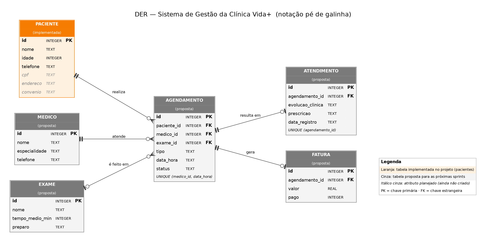
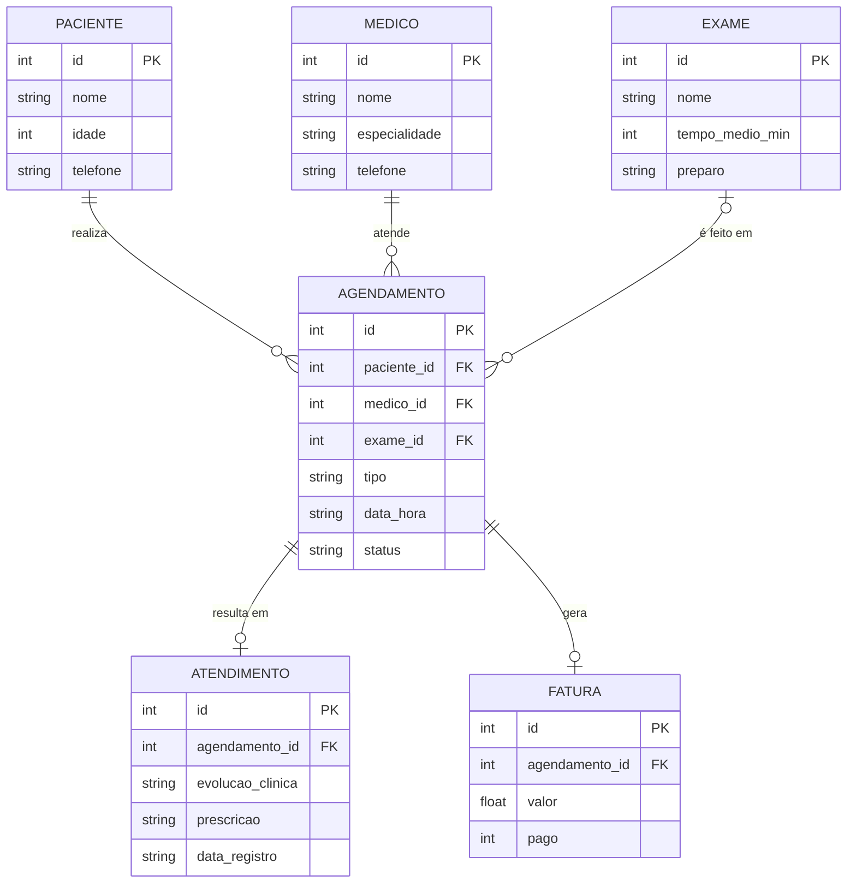

# Modelagem de dados — DER da Clínica Vida+

> **Situação atual:** apenas a tabela `pacientes` está implementada no projeto (SQLite). As demais entidades são a **proposta de modelagem** para as próximas sprints, derivada dos requisitos funcionais RF01 a RF07.

## 1. Entidades

| Entidade | Situação | Origem nos requisitos | Atributos |
|---|---|---|---|
| PACIENTE | **Implementada** (id, nome, idade, telefone) | RF01 | id (PK), nome, idade, telefone; planejados: cpf, endereco, convenio |
| MEDICO | Proposta | RF02 | id (PK), nome, especialidade, telefone |
| EXAME | Proposta | RF03 | id (PK), nome, tempo_medio_min, preparo |
| AGENDAMENTO | Proposta | RF04 | id (PK), paciente_id (FK), medico_id (FK), exame_id (FK, opcional), tipo, data_hora, status |
| ATENDIMENTO | Proposta | RF05 | id (PK), agendamento_id (FK), evolucao_clinica, prescricao, data_registro |
| FATURA | Proposta | RF06 | id (PK), agendamento_id (FK), valor, pago |

O relatório mensal (RF07) não é uma tabela: ele é calculado a partir de `agendamento`, `atendimento` e `fatura`.

## 2. Relacionamentos e cardinalidades

| Relacionamento | Cardinalidade | Leitura |
|---|---|---|
| PACIENTE realiza AGENDAMENTO | 1 : N | Um paciente tem zero ou vários agendamentos; cada agendamento é de exatamente um paciente |
| MEDICO atende AGENDAMENTO | 1 : N | Um médico tem zero ou vários agendamentos; cada agendamento é de exatamente um médico |
| EXAME é feito em AGENDAMENTO | 0..1 : N | Um agendamento pode ter um exame ou nenhum (quando é consulta); um exame pode estar em vários agendamentos |
| AGENDAMENTO resulta em ATENDIMENTO | 1 : 0..1 | Um agendamento tem no máximo um atendimento registrado; cada atendimento pertence a um agendamento |
| AGENDAMENTO gera FATURA | 1 : 0..1 | Um agendamento gera no máximo uma fatura; cada fatura pertence a um agendamento |

**Regras de integridade:**
- `UNIQUE (medico_id, data_hora)` em `agendamento`: impede dois agendamentos para o mesmo médico no mesmo horário (RF04, prevenção de conflitos).
- `UNIQUE (agendamento_id)` em `atendimento`: garante um atendimento por agendamento.
- O histórico de evolução por paciente (RF05) é obtido ligando `paciente` → `agendamento` → `atendimento`.

## 3. Fora do banco

A **fila de atendimento** (Tarefa 4) fica em memória (`FilaAtendimento`) e as **regras lógicas** (Tarefa 3) são funções (`regras.py`). Por isso não aparecem no DER. Em uma evolução do sistema, as variáveis das regras poderiam vir do banco: A (agendamento) de `agendamento` e D (pagamentos em dia) de `fatura.pago`.

## 4. Diagrama em Mermaid (renderiza direto no GitHub)

> No Mermaid, `PACIENTE` mostra só os atributos já implementados. Os planejados (cpf, endereco, convenio) aparecem apenas na imagem, em itálico cinza.

## 5. Texto sugerido para o trabalho escrito

> Para sustentar os requisitos funcionais levantados, foi elaborado o Diagrama Entidade-Relacionamento (DER) do sistema, na notação pé de galinha. O modelo é composto por seis entidades: Paciente, Médico, Exame, Agendamento, Atendimento e Fatura. O Agendamento é a entidade central, pois relaciona o paciente ao médico (e, quando for o caso, ao exame) em um horário, e dele derivam o registro do atendimento, com a evolução clínica, e a cobrança. Uma restrição de unicidade sobre médico e data/hora evita conflitos de agendamento. Na versão atual do sistema, está implementada a entidade Paciente, em SQLite; as demais constituem a proposta de evolução para as próximas sprints.

(Ajuste a última frase se, até a entrega, você implementar mais tabelas.)
